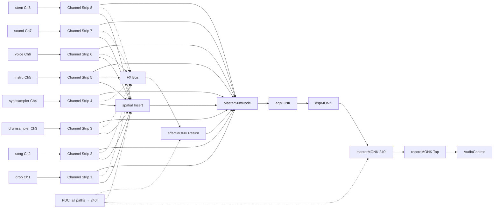
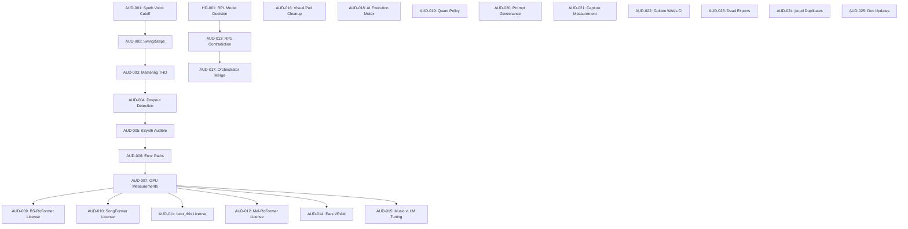

# Dependency Graph — audioMONASTRY

## Component Dependencies (Mermaid)

```mermaid
graph TD
    %% Browser Layer
    Browser[Browser ×4 Users]
    React[React 19 App]
    Adapters[16 Plugin Adapters]
    Worklets[AW Processors ×16]
    WASM[Rust WASM Kernels]
    StateSync[State Sync Socket.io]

    Browser --> React
    React --> Adapters
    React --> Worklets
    React --> WASM
    React --> StateSync

    %% Server Layer
    Server[server.ts Express]
    AIOrch[AI Orchestrator]
    SessionMgr[Session Manager]
    PluginLocks[Plugin Locks]
    FleetWiring[Fleet Wiring]
    Routes[API Routes]

    Server --> AIOrch
    Server --> SessionMgr
    Server --> PluginLocks
    Server --> FleetWiring
    Server --> Routes

    %% AI Layer
    ProviderRouter[Provider Router]
    JobManager[Job Manager]
    ModelManager[Model Manager]
    MCPRuntime[MCP Runtime]
    CostTracker[Cost Tracker]

    AIOrch --> ProviderRouter
    AIOrch --> JobManager
    AIOrch --> ModelManager
    AIOrch --> MCPRuntime
    AIOrch --> CostTracker

    %% RunPod Layer
    RunPodBrain[Brain Pod A40]
    RunPodEars[Ears Pod A40]
    RunPodVoice[Voice Pod A40]
    RunPodMusic[Music Pod A40]
    RunPodAudioGen[AudioGen Pod 4090]
    RunPodStudio[Studio Pod A40]
    RunPodAudioBrain[AudioBrain Pod 4090]
    RunPodSong[Song Pod 4090]
    RunPodVis[Vis Pod A40]

    ProviderRouter --> RunPodBrain
    ProviderRouter --> RunPodEars
    ProviderRouter --> RunPodVoice
    ProviderRouter --> RunPodMusic
    ProviderRouter --> RunPodAudioGen
    ProviderRouter --> RunPodStudio
    ProviderRouter --> RunPodAudioBrain
    ProviderRouter --> RunPodSong
    ProviderRouter --> RunPodVis

    %% Data Layer
    Supabase[(Supabase PostgreSQL)]
    R2[(Cloudflare R2)]
    HetznerFleet[Hetzner Fleet 5]

    Server --> Supabase
    Server --> R2
    Server --> HetznerFleet

    %% Plugin Contracts
    Contract[pluginContract.ts]
    Registry[registry.ts]
    SignalTopo[signalTopology()]

    Adapters -.-> Contract
    Registry -.-> Contract
    Worklets -.-> Contract

    %% Audio Graph
    V2Graph[V2StudioGraph]
    V2Monitor[V2MonitorGraph]
    V2Sink[V2SinkProcessor]
    MasterSum[MasterSumNode 240f]
    PDC[PDC Compensation]

    Worklets --> V2Graph
    V2Graph --> MasterSum
    MasterSum --> PDC
    V2Graph --> V2Monitor
    V2Sink --> AudioCtx[AudioContext Dest]

    %% Cross-cutting
    StateSync <---> SessionMgr
    PluginLocks <---> SessionMgr
    FleetWiring -.-> RunPodBrain
    FleetWiring -.-> RunPodEars
```

## Plugin Signal Topology



## AI Model → Pod Mapping

```mermaid
graph TD
    subgraph "A40 48GB Pods (8)"
        Brain[Brain Pod] --> Qwen30B[qwen3-30b-a3b-awq 22.78GB]
        Brain --> Qwen4B[qwen3-4b 8.70GB]
        
        Ears[Ears Pod] --> Whisper[whisper-large-v3 5.75GB]
        Ears --> CLAP[clap-music 0.73GB]
        Ears --> MERT[mert-v2-330m 2.36GB]
        Ears --> QwenAudio[qwen2-audio-7b 15.65GB]
        Ears --> Pyannote[pyannote-diarization 0.04GB]
        Ears --> AST[ast-audioset 0.65GB]
        
        Voice[Voice Pod] --> TTS17B[qwen3-tts-17b 4.21GB]
        Voice --> TTSVD[qwen3-tts-voicedesign 4.21GB]
        Voice --> TTSBase[qwen3-tts-06b-base 2.34GB]
        Voice --> ACE_Shared[acestep-v15-shared 9.40GB]
        
        Music[Music Pod] --> ACE_SFT[acestep-v15-xl-sft 20.02GB]
        Music --> ACE_Turbo[acestep-v15-xl-turbo 20.02GB]
        Music --> ACE_LM[acestep-5hz-lm-4b 7.85GB]
        Music --> ACE_Shared2[acestep-v15-shared 9.40GB]
        
        Studio[Studio Pod] --> BS6[bs-roformer-sw-6stem 0.83GB]
        Studio --> HTDemucs[htdemucs-6s 0.31GB]
        Studio --> MOSS_SFX[moss-soundeffect-v2.0 10.46GB]
        Studio --> ACE_XL[acestep-v15-xl-base 20.02GB]
        
        AudioBrain[AudioBrain Pod] --> Omni[qwen3-omni-30b 25.68GB]
        AudioBrain --> MFlamingo[music-flamingo 15.42GB]
        
        Song[Song Pod] --> MFlamingo2[music-flamingo 15.42GB]
        Song --> Yue2[yue2-3b ~24GB]
        
        Vis[Vis Pod] --> MasterPlayer[master-player 8GB]
        Vis --> MFlamingo3[music-flamingo 15.42GB]
        Vis --> MGSmall[musicgen-small 4GB]
        Vis --> SongStart[nateraw/musicgen-songstarter 6GB]
        Vis --> NVENC[NVENC H.264/HEVC]
        Vis --> VisualOut[/visual-out stream]
    end
```

## Task Dependencies (Backlog)



## Critical Path

```
AUD-001 → AUD-002 → AUD-003 → AUD-007 → AUD-014 → AUD-013 (HD-001)
     │       │       │       │       │       │
    2d      3d      2d      5d      2d      1d
    ──────────────────────────────────────────
    Total: ~15 days minimum (sequential critical path)
```

*Generated from commit 00f4b0b · 2026-11-09*