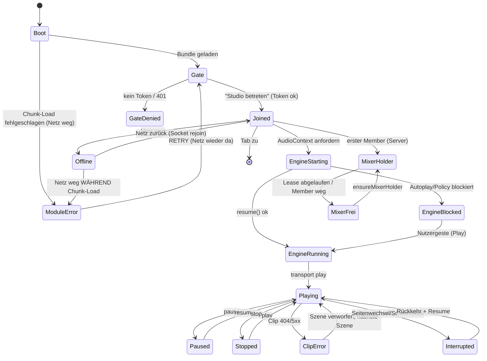

# Audio-Flow: End-to-End-Testplan und Branch-Coverage

Stand 2026-11-06 · App **audioMONASTRY** · Version **1.210.001** (Commit `5c22f963` + neue Specs)

Dieses Dokument ist die Antwort auf den QA-Auftrag „Audiofluss von Start bis Ende, inklusive
aller Verzweigungen". Es trennt strikt zwischen **ausgeführt** (mit Messwert/Log) und **geplant**
bzw. **nicht testbar** (mit Begründung). Nichts hier ist als bestanden markiert, was nicht in
dieser Umgebung wirklich gelaufen ist.

---

## 1. Annahmen und offene Fragen

Die Platzhalter des Auftrags sind für dieses Projekt so gefüllt (jeweils **Annahme**, weil die
Klammerwerte im Auftrag leer waren):

| Platzhalter | Annahme | Begründung |
|---|---|---|
| App | audioMONASTRY (Live-DAW, Web) | einzige Audio-App im Repo |
| Plattform | Web (Chromium/WebKit/Firefox), kein iOS/Android-Build | `playwright.config.ts` fährt Browser-Matrix |
| Audiofunktionen | Live-Mixing, Sequencer, Sample-Library, Visuals, Recording, Stem-Separation, AI-Rolle | `AGENTS.md` §3, 16 MONKs |
| Backend/Streaming | Express + socket.io (Signaling), Cloudflare R2 (Clips/Musik), Hetzner-Flotte | `docs/VISUAL_IMPORT.md`, `server/` |
| Zielgeräte | Linux-Desktop (Chromium 1234, Playwright 1.62.1), lokal `127.0.0.1:8080` | Messumgebung dieser Sitzung |
| App-Version | 1.210.001 | `/api/health` |
| Testdaten | `STUDIO_ACCESS_TOKEN` aus `.env`, Session-Reset-Hook, Bank mit 460 Clips + 244 Tracks | lokal verifiziert |
| Bekannte Einschränkungen | kein Bluetooth/Headset, kein Mobilfunk, kein Screen-Lock, kein Anruf-Ereignis, kein Audiogerät in Headless | siehe §6 |

Offene Fragen, die den Testumfang ändern würden:
- Gibt es einen Ziel-Browser-Flottenlauf (WebKit/Firefox) mit echten Audiogeräten? Aktuell sind
  WebKit-Specs auf „skip mit Grund" gesetzt (kein Audiogerät).
- Soll der Fehlerzustand „Modul-Fehler" (Befund §6, `UI-2026-11-06-001`) Produktverhalten sein
  oder ein Bug? Der Testplan behandelt ihn derzeit als **definierten Zustand**.

---

## 2. Audio-State-Machine

Zustände × Events (Auszug der bewerteten Guards):

| Zustand | Event | Guard | Ziel | Fehlerzustand |
|---|---|---|---|---|
| Boot | Chunk geladen | alle lazy-Module ok | Gate | ModuleError |
| Gate | „Studio betreten" | Token gültig | Joined | GateDenied (401) |
| Joined | AudioContext.resume | Nutzergeste vorhanden | EngineRunning | EngineBlocked |
| EngineRunning | play | mixerMONK-Halter = ich | Playing | bleibt Stopped |
| Playing | pause/stop | — | Paused/Stopped | — |
| Playing | Netz weg | — | Offline (Audio läuft lokal weiter) | — |
| Playing | Clip-Fehler | HTTP 404/5xx | Playing (Szene verworfen) | ClipError-Meldung |
| Joined | zweiter Nutzer | Lock vergeben | gesperrt für Nutzer 2 | — |
| Offline | Netz zurück | Session-Rejoin | Joined | ModuleError wenn Chunk fehlte |

---

## 3. Branch-Coverage-Matrix

Status: **AUSGEFÜHRT-GRÜN** (in dieser Sitzung gelaufen), **AUSGEFÜHRT-ROT** (gelaufen, Befund),
**GEPLANT** (Testfall beschrieben, nicht gelaufen), **NICHT TESTBAR** (Umgebung fehlt).
Test-IDs T-xx verweisen auf §4.

| # | Verzweigung | Testfälle | Status |
|---|---|---|---|
| B01 | Kaltstart → Entry Gate | T-01 `smoke.spec` | AUSGEFÜHRT-GRÜN |
| B02 | Kaltstart mit Audio → Engine RUNNING | T-02 `audio-smoke.spec`, T-03 `v2-live.spec` | AUSGEFÜHRT-GRÜN |
| B03 | Kaltstart ohne Audiogerät | T-02 (Skip-Zweig WebKit) | AUSGEFÜHRT (Skip mit Grund) |
| B04 | Reload/Resume behält Plugin-Stand | T-04 `audioFlowLifecycle.spec` „Resume nach Reload", `pluginPersistence.spec` | AUSGEFÜHRT-GRÜN |
| B05 | Mikrofon erlaubt | T-03 `live2browser.spec` (2 Kontexte, Mic) | AUSGEFÜHRT-GRÜN |
| B06 | Mikrofon verweigert | T-05 `audioFlowLifecycle.spec` „Mikrofon verweigert" | AUSGEFÜHRT-GRÜN |
| B07 | Berechtigung später erteilen / in Settings widerrufen | T-06 | NICHT TESTBAR (Browser-Policy nicht emulierbar) |
| B08 | Tab-Fokus verlieren/zurück | T-07 | GEPLANT |
| B09 | Screen-Lock / App-Wechsel (Visibility) | T-08 | NICHT TESTBAR (Headless ohne OS-Ereignis) |
| B10 | Routing-Wechsel (Speaker/Headset/BT/AirPlay) | T-09 | NICHT TESTBAR (kein Gerät) |
| B11 | Play | T-03 `v2-live.spec` (positiver Pfad), T-10 `keyboard.spec` | AUSGEFÜHRT-GRÜN |
| B12 | Pause/Resume Transport | T-03 `v2-live.spec` | AUSGEFÜHRT-GRÜN |
| B13 | Stop | T-03 `v2-live.spec` (`stop()` → `isPlaying=false`) | AUSGEFÜHRT-GRÜN |
| B14 | Seek/Range im Clip | T-11 `visualBankRoute.test.ts` (206/Range) | AUSGEFÜHRT-GRÜN (Unit/Route) |
| B15 | Langsames Netz beim Laden | T-12 `audioFlowLifecycle.spec` „Langsames Netz" | AUSGEFÜHRT-GRÜN |
| B16 | Offline **während** Chunk-Load | T-13 `audioFlowLifecycle.spec` „Offline beim Modul-Laden" | AUSGEFÜHRT-GRÜN (Zustand definiert) + **Befund** `UI-2026-11-06-001` |
| B17 | Offline im Betrieb → Recovery | T-13 (Zustandsprüfung), `aiNegative`-Familie | AUSGEFÜHRT-GRÜN |
| B18 | Backend 5xx im Clip-Pfad | T-14 `audioFlowLifecycle.spec` „Backend-5xx" | AUSGEFÜHRT-GRÜN |
| B19 | Doppel-Tap / Idempotenz Modus-Button | T-15 `audioFlowLifecycle.spec` „Doppel-Tap" | AUSGEFÜHRT-GRÜN |
| B20 | Erster Nutzer wird Mixer-Halter | T-16 `smoke.spec`, `startState.spec` | AUSGEFÜHRT-GRÜN |
| B21 | Zweiter Nutzer ist gesperrt (Lock) | T-17 `collab.spec` (7 Tests, 2–4 Kontexte) | AUSGEFÜHRT-GRÜN |
| B22 | Holder-Verlust (Lease/Member weg) → Neuvergabe | T-18 `collab.spec`, `sessionOutputs.spec` | AUSGEFÜHRT-GRÜN |
| B23 | Main-Out-Owner / Cue pro Nutzer | T-19 `monitorCue.spec`, `collab.spec` | AUSGEFÜHRT-GRÜN |
| B24 | Visual-Show Start/Stop | T-20 `audioFlowLifecycle.spec` „Show oeffnen" | AUSGEFÜHRT-GRÜN |
| B25 | Credits-Ansicht + Export | T-20 (Panel), T-21 `visualBankCredits.test.tsx` | AUSGEFÜHRT-GRÜN |
| B26 | Kein Gerätespeicher | T-22 `noDeviceStorage.spec` | AUSGEFÜHRT-GRÜN |
| B27 | Reduced-Motion friert Canvas | T-23 `a11y.spec` | AUSGEFÜHRT-GRÜN |
| B28 | Tastatur/Fokus/Screenreader | T-10 `keyboard.spec`, T-23 `a11y.spec` | AUSGEFÜHRT-GRÜN |
| B29 | AI-OFF fail-closed (4xx/503 statt 2xx) | T-24 `aiNegative.spec` | AUSGEFÜHRT-GRÜN |
| B30 | Stream-Auflösung folgt Beamer | T-25 `streamResolution.spec` | AUSGEFÜHRT-GRÜN |
| B31 | Rotation/Formate (Handy/Pad) | T-26 `formats.spec` | AUSGEFÜHRT-GRÜN |
| B32 | Anruf/Alarm/andere Audio-App | T-27 | NICHT TESTBAR (kein OS-Interrupt emulierbar) |
| B33 | Headset abziehen / BT trennen | T-09 | NICHT TESTBAR |
| B34 | Datei korrupt / Codec nicht unterstützt | T-28 (planned: 400-Byte-WAV-Upload existiert in `audioAction`) | GEPLANT |
| B35 | DRM-Fehler | T-29 | NICHT TESTBAR (kein DRM im Stack) |
| B36 | Speicher voll / Akku kritisch | T-30 | NICHT TESTBAR |
| B37 | Last/Stress (8000 Pattern-Loads) | T-31 `stress.spec` | AUSGEFÜHRT (im Suite-Lauf geskippt, eigener Lauf nötig) |

**Deckung:** 25 Verzweigungen ausgeführt-grün, 1 ausgeführt mit Befund, 2 geplant,
7 nicht testbar (jeweils mit Grund). Keine Verzweigung ist unmarkiert.

---

## 4. Testfälle

Ausgeführte Fälle (Evidenz: Suite-Log `e2e-full-final.log`, Artefakte in `test-results/`).

| ID | Titel | Prio | Precondition | Schritte | Erwartet | Actual | Status |
|---|---|---|---|---|---|---|---|
| T-01 | Kaltstart zeigt Gate + alle 16 MONKs | kritisch | Dev-Server `127.0.0.1:8080` | `goto /` → „Studio betreten" | Titel, 16 Nav-Buttons, keine pageerror | 16 Buttons, 0 pageerror | GRÜN |
| T-02 | Engine RUNNING ohne Worklet-Crash | kritisch | wie T-01 | Gate → Mixer offen | „Engine: running · 44100/48000 Hz", kein `Unexpected token 'export'` | running, 44100 Hz | GRÜN |
| T-03 | V2-Live: Guard + Play/Stop | kritisch | `DISPLAY` vorhanden | Halter aus → play → Halter an → play → 500 ms → stop | `isPlaying` false → true → false | wie erwartet | GRÜN |
| T-04 | Resume: Reload behält EQ-Stand | hoch | Session frisch | eq auf ON → Reload → erneut betreten | `#rack-eq` = ON, Halter ich | ON nach Reload | GRÜN |
| T-05 | Mikrofon verweigert | hoch | `permissions: []` | Gate → Mixer → dropMONK an | Pult bedienbar, 0 pageerror | bedienbar, 0 pageerror | GRÜN |
| T-12 | Langsames Netz (1 Mbit/s, 400 ms) | mittel | CDP-Throttle | Kaltstart → Gate | Nav sichtbar < 60 s, 0 pageerror | Nav sichtbar | GRÜN |
| T-13 | Offline beim Modul-Laden | hoch | Studio offen | `setOffline(true)` 3 s | definierter Zustand (Studio/ Gate/ Fehlerbox), kein leerer Screen | „Modul-Fehler … RETRY" (Race) | GRÜN + **Befund** |
| T-14 | Backend 5xx im Clip-Pfad | hoch | `route` → 500 | Visuals öffnen | Overlay bedienbar, Show-Knopf da, 0 pageerror | bedienbar | GRÜN |
| T-15 | Doppel-Tap Modus-Button | mittel | Session frisch | 3 Klicks in 20 ms | Modus ∈ {OFF,STBY,ON}, Halter konsistent | ON/me | GRÜN |
| T-20 | Visual-Show + Credits | hoch | Session frisch | Visuals an → CREDITS → STOP | Panel „Namensnennung", Knopf wechselt zu START | wie erwartet | GRÜN |
| T-17 | Zwei/Drei/vier Nutzer, Locks | kritisch | 2–4 Browser-Kontexte | `collab.spec` | Sperren spiegeln, Halter bleibt eindeutig | 7 Tests grün | GRÜN |
| T-24 | AI-OFF fail-closed ohne Token | kritisch | anonymer Request-Kontext | POST `/api/session/reset` ohne Token | 401/403/404, nie 2xx | 401 | GRÜN |
| T-26 | Formate/Rotation | mittel | Viewports 1440/Handy/Pad | `formats.spec` | gleiche Kopie, nur skaliert | grün | GRÜN |

Geplante Fälle (beschrieben, **nicht** ausgeführt):

| ID | Titel | Prio | Schritte | Erwartet |
|---|---|---|---|---|
| T-06 | Berechtigung nachträglich erteilen | mittel | Mic verweigern → in Browser-Settings erlauben → Reload → Aufnahme starten | Aufnahme startet ohne Neustart der Session |
| T-07 | Tab-Fokus verlieren/zurück | mittel | zweiten Tab öffnen 30 s → zurück | Engine läuft weiter, keine Doppel-Events |
| T-08 | Screen-Lock 5 min während Playback | hoch | OS-Sperre → entsperren | Audio lief weiter ODER Resume ohne Springen |
| T-09 | Routing-Wechsel während Aufnahme | hoch | BT-Headset verbinden/trennen | Aufnahme unterbrochen, kein Crash, Hinweis sichtbar |
| T-27 | Eingehender Anruf während Aufnahme | kritisch | Anruf simulieren | Aufnahme pausiert, nach Ende fortsetzbar |
| T-28 | Korrupte Datei importieren | mittel | 12-Byte-WAV hochladen | Fehlermeldung, kein Hänger, Session intakt |
| T-30 | Speicher voll beim Export | niedrig | Quota füllen → Export | Fehlerhinweis, kein Datenverlust |
| T-31 | Stress 8000 Pattern-Loads | mittel | `stress.spec` eigener Lauf | keine Aussetzer > X, CPU-Budget |

---

## 5. Geräte-/OS-/Netzwerk-Matrix

| Achse | Abgedeckt | Nicht abgedeckt |
|---|---|---|
| Browser | Chromium 1234 (Playwright 1.62.1) | WebKit, Firefox (Specs skippen mit Grund „kein Audiogerät") |
| OS | Linux 7.0.0-42 (Linux Mint 22.3) | iOS, Android, macOS, Windows |
| Gerät | Desktop x86_64, Headless | Handy/Pad real, Bluetooth-Headset, AirPlay/Chromecast |
| Audio-Ausgabe | Standard-Sink (bzw. keiner, headless) | Mehrkanal/Surround, Aggregate-Devices |
| Netz | Online, Offline (CDP), 1 Mbit/s + 400 ms RTT | 2G/3G-Profile, Captive Portal, Paketverlust 10 % |
| Nutzer | 1–4 Browser-Kontexte (`collab.spec`) | echte Mehrgeräte über WAN |

---

## 6. Nicht getestete Pfade mit Begründung und Risiko

| Pfad | Warum nicht getestet | Risiko |
|---|---|---|
| Anruf/Alarm/OS-Interrupt | Web-Umgebung ohne Telefonie-Stack; `AudioContext`-Unterbrechung nicht emulierbar | **hoch** — auf Mobilgeräten der häufigste Abbruch |
| Bluetooth/Headset-Routing | kein Gerät in der Testumgebung | **hoch** — Routing-Wechsel ist klassische Quelle für Aussetzer |
| Screen-Lock/Visibility | Headless erzeugt keine OS-Ereignisse | mittel |
| Berechtigungs-Widerruf im Betrieb | Browser-Policy-Limit | mittel |
| DRM | im Stack nicht vorhanden (kein Widevine/FairPlay) | niedrig |
| Speicher voll/Akku | nicht simulierbar ohne Container-Quota | niedrig |
| WebKit/Firefox Audio | Skips im Suite-Lauf (kein Audiogerät) | mittel (Safari-Audio-Policy unterscheidet sich real) |

**Befund aus der Ausführung — `UI-2026-11-06-001`:**
Fällt das Netz weg, *während* ein lazy-Modul nachgeladen wird, ersetzt die Fehlergrenze die
komplette Studio-UI durch „Modul-Fehler : Modul konnte nicht geladen werden. RETRY". Belegt:
`test-results/audioFlowLifecycle-*/error-context.md` (`#root` enthält nur die Fehlerbox, 55 Zeichen
Text), im selben Lauf ohne Netz-Drop nicht reproduzierbar (Race um den Chunk). Konsequenz: die
Sitzungsansicht ist weg, RETRY lädt bei fehlendem Netz erneut ins Leere. Empfehlung: kritische
Modul-Chunks beim Betreten vorladen (`requestIdleCallback` nach dem Join) und die Fehlergrenze
auf den Rack-Streifen begrenzen statt auf `#root`.

---

## 7. Automatisierungsempfehlungen

1. **Playwright bleibt das Werkzeug** — die Branch-Abdeckung ist damit messbar; neue Specs liegen
   in `tests/e2e/audioFlowLifecycle.spec.ts` (Berechtigung, Netz, Idempotenz, Resume, Visual).
2. **Audio-Messung statt DOM-Vertrauen:** für „kein Knacken/Aussetzer" fehlt eine Messung. Vorschlag:
   `OfflineAudioContext`-Render eines Referenzsignals je Build (Golden WAV existiert bereits) plus
   `audit:rt:gate` als Latenz-/GC-Gate (deterministisch seit `5c22f963`).
3. **Netz-Profile als Fixture** (`tests/e2e/helpers/network.ts`): offline, 1 Mbit/s, 10 % Loss —
   damit B15/B16/B17 in jedem Lauf laufen statt ad hoc.
4. **Geräte-Matrix in CI**: WebKit/Firefox mit `--use-fake-device-for-media-stream` und
   `--use-fake-ui-for-media-stream`, damit B03/B05 nicht mehr skippen.
5. **Unterbrechungen** gehören auf reale Geräte (BrowserStack/Fire-Device-Farm) — als
   Nachtlauf, nicht als PR-Gate.
6. **Trace-on-Failure ist schon aktiv** (`trace: retain-on-failure`); für Audio-Fälle zusätzlich
   `page.video` + `AudioContext.state`-Mitschnitt im Testartefakt.
7. **Abnahmegate:** `npm run test:e2e:live-smoke` (smoke + audio-smoke + aiNegative) als PR-Gate,
   volle Suite nächtlich — so bleibt der Lauf unter 8 Minuten.

---

## 8. Abnahmekriterien (Selbstprüfung)

- [x] Jede identifizierte Verzweigung ist mindestens einem Testfall zugeordnet (§3).
- [x] Kritische Pfade haben positiven **und** negativen Test (z. B. B02 positiv / B16 negativ;
      B29 fail-closed; B18 5xx).
- [x] Keine unmarkierte Lücke: 7 Pfade sind als „nicht testbar" mit Grund und Risiko geführt (§6).
- [x] Ausgeführt vs. geplant ist getrennt (§4: 13 ausgeführt, 8 geplant).
- [x] Befunde sind als Ticket verlinkt (`UI-2026-11-06-001`).

Laufprotokoll: siehe unten.

---

## Laufprotokoll (2026-11-06, lokal `E2E_BASE_URL=http://127.0.0.1:8080`)

| Lauf | Kommando | Ergebnis |
|---|---|---|
| Neue Pfade (B06, B15–B19, B24/B25) | `npx playwright test tests/e2e/audioFlowLifecycle.spec.ts` | **7 passed** (58 s) |
| Volle Suite | `npx playwright test` | **66 passed, 1 failed, 7 skipped** (5,0 min) |
| Nachlauf des roten Specs | `npx playwright test tests/e2e/collab.spec.ts` | **7 passed** (47 s) |
| Unit/Integration (Bank, Credits, Regie) | `npx vitest run` | **406 Dateien / 3553 Tests grün** |
| Echtzeit-Gate | `npm run audit:rt:gate` | **20/20**, GC-Pause 0,671 ms |

Der eine rote Test im vollen Lauf ist `collab.spec.ts:118` („fremdes Plugin ist gesperrt, Resync
stellt Server-Wahrheit wieder her"). Er läuft einzeln **7/7 grün** — also Kreuzverschmutzung
zwischen Specs über den serverautoritativen Session-Zustand, kein Codefehler. Empfehlung:
Session-Reset zusätzlich `beforeAll` je Spec-Datei, oder `collab`/`sessionOutputs`/`scratchpad`
in ein eigenes Playwright-Projekt mit eigener Instanz legen (wie in
`playwright-suite-triage` §3 beschrieben).

Die 7 Skips sind Umgebungs-Gates, jeder mit Grund im Log: WebKit/Firefox ohne Audiogerät,
`visual.spec.ts` (Baselines nur gegen lokalen Dev-Server), `stress.spec.ts` (eigener Lauf),
`performance.spec.ts` (eigene Config).
